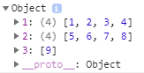
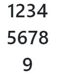
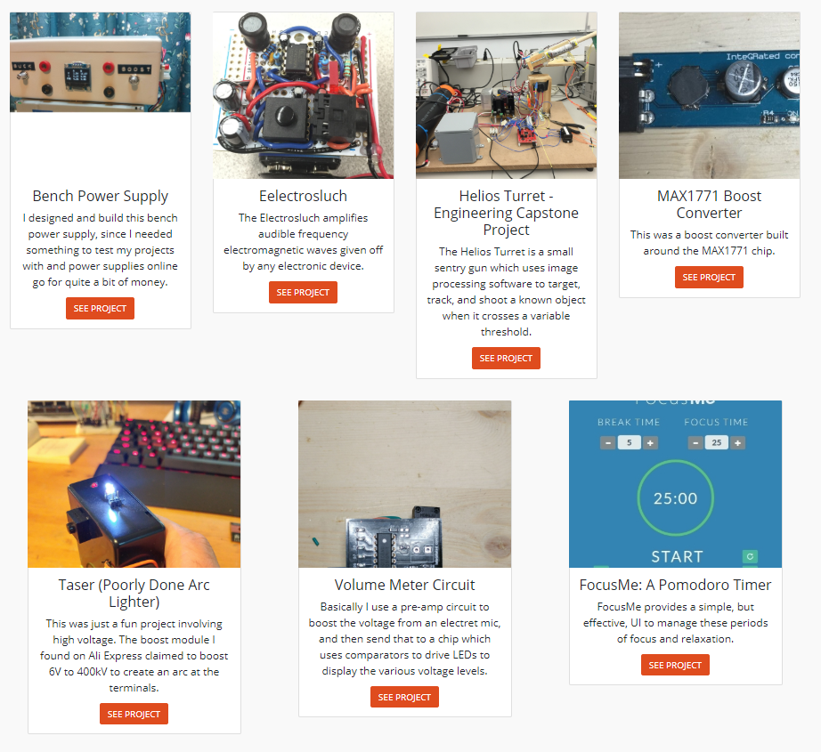

See this code in action on [Codepen](https://codepen.io/irowell/pen/eazeXw).

## The problem

So not too long ago I ran into an issue when building the projects page for my website.

What I wanted was to show my projects in rows of 4 on the page. I grab a list of projects from a databse when the page renders, and I could have an arbitrary amount of projects, so I wanted to display rows with a max of 4 items per row. I also wanted to be able to add or remove projects as necessary, without thinking about the layout of the page.

I’m using Bootstrap for helping to style the website, and the issue is there doesnt appear to be a nice way for me to dynamically render rows with items in them (you have to decide the rows and columns up font to define the grid).

So I needed a way for this page to accept an arbitrary amount of items, and dispaly 4 items per row.

## The code

Lets break down the code that was necessary for me to acheive this (I’ve simplified it for demonstration purposes, but you can see how to adjust it for your needs).

```js
class Items extends React.Component {
  constructor() {
    super()
    this.state = {
      items: [1, 2, 3, 4, 5, 6, 7, 8, 9],
    }
    this._createItemList.bind(this)
  }
  _createItemList() {
    let rows = {}
    let counter = 1
    this.state.items.forEach((item, idx) => {
      rows[counter] = rows[counter] ? [...rows[counter]] : []
      if (idx % 4 === 0 && idx !== 0) {
        counter++
        rows[counter] = rows[counter] ? [...rows[counter]] : []
        rows[counter].push(item)
      } else {
        rows[counter].push(item)
      }
    })
    return rows
  }
  render() {
    let rows = this._createItemList()
    console.log(rows)
    return (
      <section className="section items">
        <div className="container">
          {Object.keys(rows).map(row => {
            return (
              <div className="row items__row" key={row}>
                {rows[row].map(item => {
                  return <h1>{item}</h1>
                })}
              </div>
            )
          })}
        </div>
      </section>
    )
  }
}

ReactDOM.render(<Items />, document.getElementById("app"))
```

We’ll try to go through it piece by piece.

### Defining the rows

#### Overview

The function below takes the list of items in our state, and creates a dictionary of rows, where the keys are the row number and the values are a list of which items should be included in that row.

```js
    _createItemList() {
        let rows = {};
        let counter = 1;
        this.state.items.forEach((item, idx) => {
          rows[counter] = rows[counter] ? [...rows[counter]] : [];
          if (idx % 4 === 0 && idx !== 0) {
            counter++;
            rows[counter] = rows[counter] ? [...rows[counter]] : [];
            rows[counter].push(item);
          } else {
            rows[counter].push(item);
          }
        });
        return rows;
  }
```

#### So whats it doing?

First, we define our `rows` object and the `counter`. The counter will increment each time we complete a row.

```js
let rows = {}
let counter = 1
```

Next, we loop through the items in our state array. We need to add the extra parameter to the `callback` function in the `forEach` loop, which will keep track of the index of the current item.

```js
this.state.items.forEach((item, idx) => {})
```

If values in the `rows` object at the current counter exist, we just want the values to stay the same (we use the `...` spread operator to acheive this), otherwise we are on a new row and want to create an empty list.

```js
rows[counter] = rows[counter] ? [...rows[counter]] : []
```

If we are on `5th` item in our array, increase the counter and push the item to the new list for that row. Otherwise just push the item to the existing list.

```js
if (idx % 4 === 0 && idx !== 0) {  /* this is where we define the number of elements per row */  counter++
  rows[counter] = rows[counter] ? [...rows[counter]] : []
  rows[counter].push(item)
} else {
  rows[counter].push(item)
}
```

Once all that is done we just return the `rows` object.

```js
return rows
```

#### Outcome

If we were to call this function with 9 items in our array and log it, we would see it return the following:



### Rendering something useful

Alright, so we now have our rows nicely defined with which items we want in them. The next part is pretty simple. We want to render each item in some element (a card, or just an `h1` tag) for a particular row. When we’ve finished with that row, move on to the next.

Bootstrap has a class called `row` which we use as the container class. Any items inside that element will appear as columns in that row.

```js
  render(){
    let rows = this._createItemList();
    return (
      <section className="section items">
        <div className="container">
          {Object.keys(rows).map(row => {
            return (
              <div className="row items__row" key={row}>
                {rows[row].map(item => {
                  return <h1>{item}</h1>;
                })}
              </div>
            );
          })}
        </div>
      </section>
    );
  }
```

We use the `Object.keys()` method on our `rows` object. This will give us a list of the keys in that object (in the case of this example it will return `[1,2,3]`). We then use `map()` to iterate through each item and return a new list.

What we’re returning is a list of `div` elements with a class of `row`. In each of those elements, we just render an `h1` tag for each item in the `rows` object.

For a list of 9 items in our state, we should get something that looks like this:



And as you add more items, the rows automatically generate to fill up the space.

Not very eye catching, I know. Implemented with cards for each of my projects ended up looking something like this:



Ok, fine, not that much more eye catching. But I hope its given you something to work with for your next project.

This was a pretty fun challenge for me, and to brag a bit I didnt really see much online for how to acheive something like this.

Yes, I’m sure something like flexbox or css grid would have worked (theres probably a simpler method). But I didn’t really know about those at the time and wanted to use the built in classes Bootstrap offered.

So I hope that I at least taught you something that couldnt be found on Stackoverflow :)

Thanks for reading!
