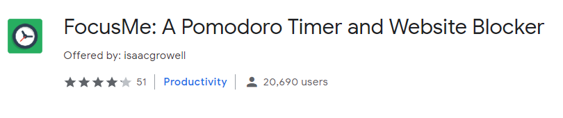

Welcome to my first post of what is hopefully many more. I’m not entirely sure how to do this yet, so bear with me.

My name is Isaac Rowell. I’m a hobbiest, web designer and wannabe inventor. I enjoy creating and designing useful things.

### The purpose of this blog

I’m starting this blog as a way to share and enhance some of the knowldge I’ve aquired since I started my path as a programmer and hobbiest. I feel one of they ways I’ll become better (and maybe get my name out there) is if I can post useful tutorials, how-to’s or even personal advice I wish I had gotten when I started.

I really admire the work of Brad Traversy, Andrew Mead and Cory Schafer and want to emulate it as much as I can. They’ve been able to provide so many people with access to lessons and material which have helped foster new careers and passions. I’ve always believed the best way to get better at something is to actually work on it and practice, little can be learned from theory alone.

### A brief history

I’ve been teaching myself coding and web development since I completed school. I came across [Learn to Code HTML & CSS](https://learn.shayhowe.com/) by Shay Howe and fell in love with creating webpages.

Over the past couple of years I fell in and out of various online tutorials, projects and frameworks (I tried to build a webapp using Laravel, spent a whole week copying the code for [Peeqo](https://peeqo.com/) when it was posted to Reddit, struggled to setup my raspberry pi for anything useful).

My first real breakthough came about a year ago, when I built [FocusMe: A Pomodoro Timer and Website Blocker](https://chrome.google.com/webstore/detail/focusme-a-pomodoro-timer/koebbleaefghpjjmghelhjboilcmfpad?utm_source=chrome-ntp-icon). Its now one of the highest rated apps when searching for a Pomodoro timer.

I spent the good part of 2 or 3 months writing the HTML/CSS and figuring out the raw javascript to put a usable extension together. I learned a lot about the web, dev tools, debugging and writing code in general.

### Whats next

I found a real passion for coding after creating that app. I’m currently taking a few classes on Udemy (I highly recommend this site, I’ve learned React, Nodejs, MySQL, even 3D printing and design). I also started taking on dev tasks at work and trying to build things for myself at home (automation site, streaming, blogs).

I love web development because its the face of the modern internet. Its what everyone sees when they look up a business or a person. Sleek pages, interactive menus, cool buttons and sliders…

Like I said above I want to share what I know and a blog will help me expand that in the process. Hit me up on one of the many social media platforms to get in touch, share some ideas or tell me what kinds of posts you want to see.

Often times when learning something new you struggle for hours or days, ask a lot of questions that might be obvious to someone else or think about giving up. I want to end this with a quote that has helped me power through a lot of those same problems.

> If you want to improve, be content to be thought foolish and stupid
> — Epicitetus
