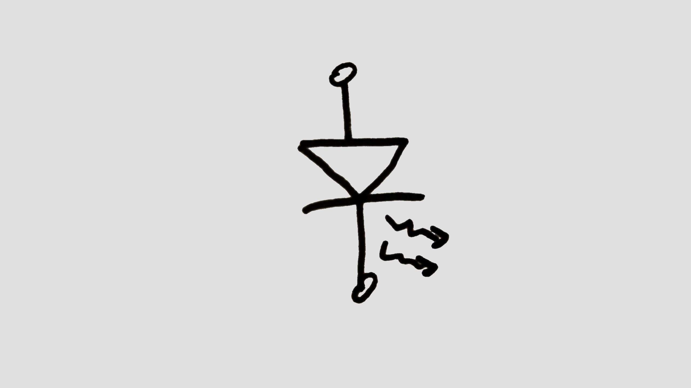
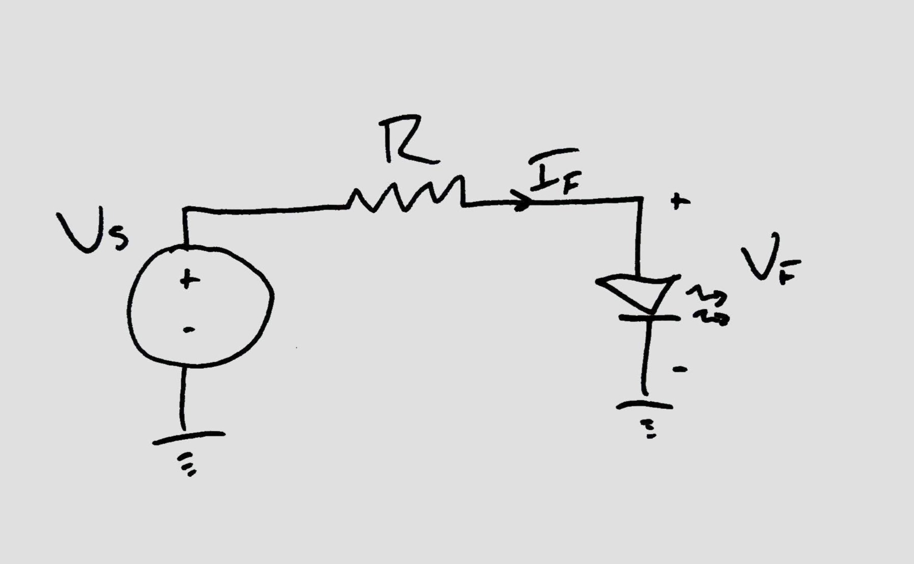
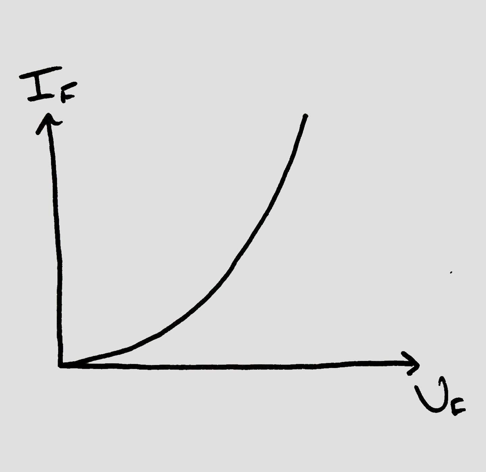
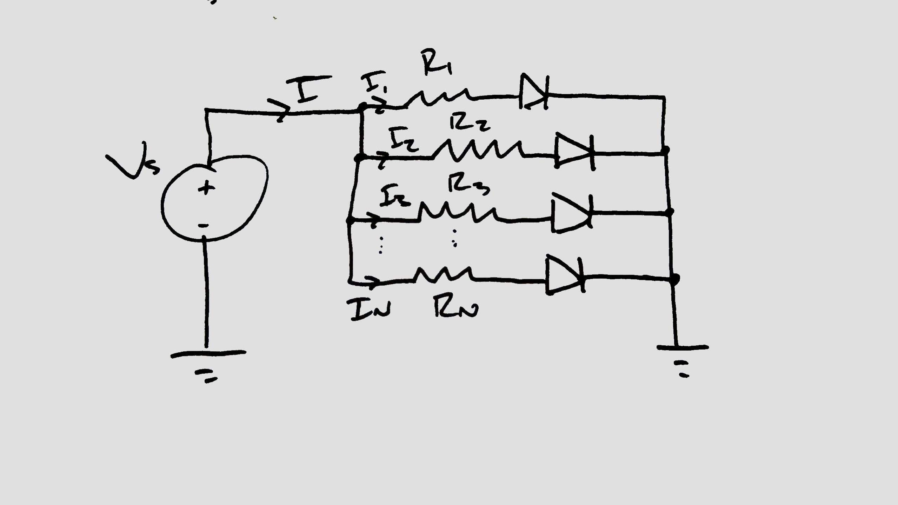
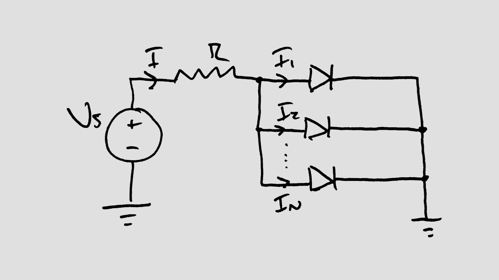
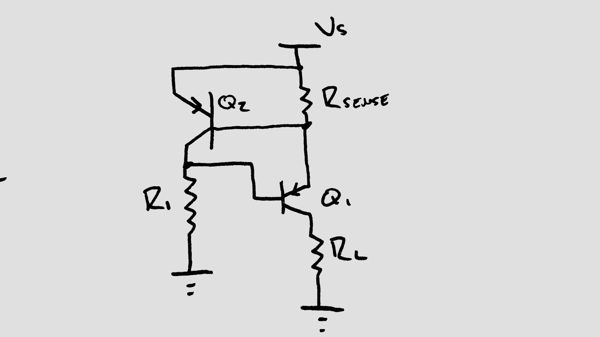

I recently purchased a 10W RGB LED for a project, and I got thinking that it might be useful to go over some basics on how LEDs work. Theres a lot that we could dive into on this, so I’m going to cover as much as we need for a good refresher course plus a little extra. I also want to use this to kick off an `Electronics Tutorials` series that will have no particular order.

## Whats an LED?

LED stands for Light Emitting Diode. Its a device that is similar to a `pn-junction` diode, except that its designed to emit visible light. An LED is made by joining *n-type* and *p-type* semiconductors together. So when forward biased, electrons on the *n-side* are excited across the junction into the *p-side* where they combine with *holes*. As they combine with holes, photons of a visible wavelength are emitted.

That means that if we have a forward voltage drop across the diode, current will flow and we get light. If we reverse the polarity of the voltage, then the diode wll block the current flow and no light will be emitted.

The schematic symbol for an LED looks like this:

There are several available options for LEDs, such as infrared, RGB and LED displays.

## Design Principles

LEDs are current dependant devices, meaning if we want to control the intensity then we need to increase or decrease the current. There are two main parameters that are always given when looking up LEDs, the `forward voltage`, which is the amount of voltage required for current to flow and the `forward current`, which is the current needed for the LED to light up to its specified intensity.

Lets take [this](https://www.digikey.com/product-detail/en/cree-inc/C503B-RAN-CZ0C0AA2/C503B-RAN-CZ0C0AA2CT-ND/6561767) LED for example from digikey. Its basic specs are as follows:

$$
\begin{gathered}
V_f = 2.1V \\
I_f = 20mA \\
Color = Red
\end{gathered}
$$

We’ll use a 5V power supply for this circuit test.

If we were to just hook up our power supply directly to the LED, we would see it blink quickly and then stay dark. We have successfully blown our LED. That is because the forward voltage was exceeded and there was nothing to limit the current flow to the LED.

So we need a `current limiting resistor` to limit the current flowing through our circuit. How do we choose one?

To paraphrase, *Kirchhoffs Voltage Law* states that the sum of the voltage potentials in a closed loop must equal 0.

$$
\begin{gathered}
V_S = 5V \\
V_F = 2.1V \\
5V = V_F +V _R \\
V_R = 2.9V
\end{gathered}
$$

So the voltage across our resistor must be 2.9V. Since we need a current of 20mA, by Ohms law the value of the resistor must be:

$$
\begin{gathered}
V = I \times R \\
2.9V = .020A \times R \\
R = 145 \Omega
\end{gathered}
$$

If you dont have the correct value, combine multiple resistors in series or use a bigger resitstor.

## What the forward voltage means

Lets say that you removed the resistor from the circuit. As we already discussed, this would cause our LED to burn out. But thats because we were using a 5V supply, which is higher than the rated 2.1V.

If we had a power supply that could output 2.1V, and connected the LED directly what do you think would happen?

Well it would light up! And if we measured the current draw, we would see that its approximately 20mA. **The forward voltage is the breakdown voltage of the diode, and the voltage at which it begins to conduct**. Do we still need a current limiting resitor then?

Well, if we were to plot `Vf` vs `If`, then we would see why not using a resistor is still a bad idea. I just did a rough sketch, but the datasheet usually contains this comparison.

The curve is exponential, so when you have a small voltage change you will experience a large increase in current, which could exceed the maximum rating and break your LED. Adding a small resistor in series will linearize the current consumption by the LED and prevent damage.

## Wiring multiple LEDs

There are some considerations needed when wiring more than one LED into your circuit.

#### Series

If we wire multiple LEDs in series, then the calculations above simply need to be adjusted to account for the additional forward voltage drops.

For example, with two LEDs

$$
\begin{gathered}
V_S = 5V \\
V_F = 2.1V \times 2 \\
5V = V_F +V _R \\
V_R = 0.8V
\end{gathered}
$$

$$
\begin{gathered}
V = I \times R \\
0.8V = .020A \times R \\
R = 40 \Omega
\end{gathered}
$$

However, if we connect too many LEDs in series, than the total required `Vf` will exceed our supply voltage, and the LEDs will not be able to conduct.

#### Parallel

We could get around the above issue by connecting the strings of LEDs in parallel. This way each branch will only draw what’s required to power each LED.

You might notice that we’re connecting a current limiting resitor to each branch. So our power consumption increases depending on the number of branches we have. I wouldnt say this is a big problem, since its functional and for general applications its easy and safe to implement.

If power consumption is a big deal, and you dont have the space for the additional components, then there is an alternative to this setup.

We could connect all of the branches together with a single resistor

You might notice that there is a big problem with this. If some LEDs die out, or overheat, then the other LED branches will end up drawing more current which can shorten the LED lifespan overtime.

*Krichhoffs current law* states that the sum of the currents flowing into and out of a node is equal to 0.

For example, lets say we have 3 branches of LEDs conencted to our power supply through one current limiting resistor.

$$
\begin{gathered}
V_S = 9V \\
V_F = 2.1V \\
I_F = 20mA \\
\end{gathered}
$$

So if we have 3 branches in parallel connected with one resistor, then that resistor needs to supply 60mA of current.

$$
\begin{gathered}
V_S = I \times R \\
9V = 60mA \times R \\
R = 150 \Omega
\end{gathered}
$$

Now, lets say that one of our LEDs blow up. Then the other two branches are going to end up drawing 30mA of current each to make up for the loss. This is above the rated current of our LEDs and cause damage over time.

As well, our LEDs will have impurities in the dye which cause the forward voltage to vary slighly between similarily manufactured LEDs. So one branch may draw more or less current than the others, which can lead to the same issues.

## Constant Current vs. Constant Voltage

The above design principles are considerations when driving your LEDs using *constant voltage*. The voltage supplied to the LEDs remains constant and the current increases or decreases depending on requirements.

As discussed above, LEDs are current dependant devices. We want to focus on keeping the current through the LED constant for a varying supply voltage. Depending on the application, we want to drive our LEDs with either a `constant voltage` or `constant current` source.

Generally, want to drive our LEDs using a `constant current` supply. This will force the current to remain within operating levels, despite variations in the forward voltage or changes in the supply voltage. That means the forward voltage of each LED will remain at a constant level, and wont swing due to heating or supply voltage variations.

#### Constant current circuit design

There are several ways to make a constant current source. One simple and effective way is to use a current limiting circuit based on NPN or PNP transitors. It will also refresh us on analog circuits and transistor analysis.

An optional resistor, `R2`, can be placed on the base of `Q2` to prevent damage in the case of a short circuit on the load.

Assuming that the current is below the threshold when the circuit is active, there is no voltage drop across the emitter and base of `Q2` and it will stay off. `R1` is conducting, and current is flowing through the load and the same current through `Rsense`.

As the current through `Rsense` increases, it increases the base-emitter voltage of `Q2` until it turns on. This causes current to flow through `R1` and will increase the voltage drop, turning off `Q1` by raising its base-emitter voltage. When `Q1` stops conducting, the current thorugh the load reduces to 0.

For `Q2` to become active, `Veb` must exceed the rated saturation voltage. This threshold voltage, combined with the resistance of `Rsense` provides the limiting.

Lets assume some design constraints.

$$
\begin{gathered}
Q_1, Q_2 = 2N3906 \\
V_{EB(sat)} = 0.65V - 0.95V \\
I_F = 20mA \\
V_S = 9V
\end{gathered}
$$

To acheive a minimum `Veb(sat)` of 0.65V to cause `Q2` to conduct and turn off `Q1`, `Rsense` needs to be

$$
\begin{gathered}
V_{EB(sat)} = 0.65V \\
I = 0.02A \\
R = 32.5 \Omega
\end{gathered}
$$

We can confirm this with an LTspice simulation. The current through the load is ~20mA. The voltage drop across `Rsense` is a little higher than 0.65V, and `Q2` is off. The voltage drop across `R1` is closer to 7.55V. This lines up with our theory. The voltage drop `Vbe` of `Q1` is approximately 8.3V-7.55V = 0.75V, so `Q1` is conducting.

Try connecting a load to draw more current. You’ll see that at a certain point, the circuit can no longer provide the required current based on the supply voltage limit and will turn on `Q2` which will shut off `Q1`.

I intend to discuss more about LED brightness control using PWM, and constant current drivers in a later post. For now I hope this was enlightening or at least a good refresher on some electroncis basics.

Thanks for reading!
