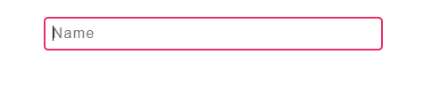

Checkout the full code on [Codepen](https://codepen.io/irowell/pen/VOMeJg).

Heres what we’ll be building:



Pretty cool right?

Basically we make it look like the placeholder is dropping down from the form input when a user starts typing. This can provide a nice user experience, since the form appears responsive when the user starts typing and the label is only shown then, so it doesnt clutter the rest of the page (especially if there are a lot of fields to fill out).

## The Code

The code for this is pretty simple.

First we start with some HTML

```html
<form class="form">
  <input
    required
    type="name"
    class="form-control"
    id="name"
    placeholder="Name"
  />
  <label class="form__label">Name</label>
</form>
```

And then spice things up with some CSS

```css
.form {
  display: flex;
  flex-direction: column;
  width: 20%;
  margin: 0 auto;
}

.form-control {
  margin-top: 10vh;
  padding: 0.5rem;
  font-size: 16px;
  border-radius: 5px;
  outline: none;
  border: 2px solid #eb2f64;
  letter-spacing: 1.3px;
}

.form__label {
  letter-spacing: 1.5px;
  margin-left: 0.5rem;
  margin-top: 0.5rem;
  transition: all 0.3s;
  font-size: 19px;
}

.form-control:placeholder-shown + .form__label {
  opacity: 0;
  visibility: hidden;
  transform: translateY(-2rem);
}
```

And thats it! Most of it is just basic styling really. The actual functionality is just these few lines:

```css
.form__label {
  ...;
  transition: all 0.3s;
  ...;
}

.form-control:placeholder-shown + .form__label {
  opacity: 0;
  visibility: hidden;
  transform: translateY(-2rem);
}
```

## So what are those lines doing?

Lets breakdown what we have above.

First, lets talk about this snippet

```css
.form-control:placeholder-shown + .form__label {
  opacity: 0;
  visibility: hidden;
  transform: translateY(-2rem);
}
```

We are selecting the `form-control` class, and using the `:placeholder-shown` selector class on that. So we are selecting the input element when the placeholder is being shown. The placeholder is shown before we type something.

Next, we use the `+` selector, which selects the first adjacent element to the first. In this case thats our label element.

So we are selecting the label element when it is adjacent to the input element with a placeholder in it.

We set the `opacity` to 0, which will make the element disappear (however its block will still remain) and then `visibility` to hidden, which wil make it like the element is no longer on the page.

After all that, we `transform` the element -2rem in the Y direction. So its going *up*.

We should now have something that looks like this


When the input has a placeholder, the label is moved up 2rem and hidden, when we start typing that selector is no longer valid and the input element “drops” 2rem and becomes visible again.

Good. Not great. We want the user to be able to see the label element drop from the top.

We can then tie all this in nicely by slowing the transition of the action

```css
.form__label {
  ... transition: all 0.3s;
  ...;
}
```

That will smooth the transition over a 0.3s period.

And thats it! We now have an interesting dropdown effect for our form elements. We can apply this across multiple inputs for a very slick looking form as users tab through and edit the fields.

Thanks for reading!
