I’ve been wanting to do a [particular project from Make Magazine](https://makezine.com/projects/wobble-bot-upcycled-cans/) for a while now, and I’m using this blog as an excuse to finally get around to it.

I want to talk about the DC motor speed control circuit. While I will try to be simple but descriptive with some of the motor theory, design principles and implementation details I’m still getting used to the blogging process and how to best convey information without being too lengthy, so bear with me.

## Overview

I’m using a **Brushed DC Motor** for this project. These are the motors that are in most small electronic toys. They’re typically cheap, small and easy to control, making them perfect for most basic home projects.

The motor is going to be used to cause a *wobble* of the robot through the centripedal force of spinning a weight around.

The motor needs to spin fast enough to overcome the intertia of the small weight, which is just a 3D printed arm with a screw and nut in it. Figuring out the best speed will just be trial and error, and I’ll talk about the optimal values when I acutally design the
project.

## Speed control

We are going to focus on **PWM** Control of the motor. PWM (Pulse Width Modulation) is a technique to get an analog signal
via digital control. PWM allows us to vary the duty cycle of a signal, effectively changing the average value. For motor control, we need a way to vary the average voltage to the motor. This will vary the amount of current being drawn which will directly affect the speed.

### Torque-Speed and Power Characteristic

For a fixed voltage, we can plot the torque-speed curve.

With no load, the motor will run at the fastest possible speed. When the motor is fully loaded and the shaft is unable to move, the motor is producing its stall torque, the maximum possible torque.

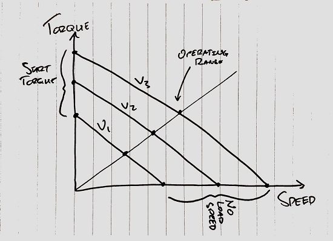

The curve for the output power of the motor can be deduced from the torque-speed curve as well, since the output power is the product of the torque and speed.

$$
{P_{out} = \dfrac{2\pi}{60} \times \tau \times N}
$$

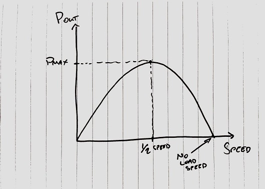

The torque-speed and power curves are directly dependent on the supply voltage to the motor.

If we adjust the input voltage, then we would shift the torque-speed curve up or down, which will give us a wider or smaller operating range for our motor speed.

Alternatively, adjusting the input voltage will change the input power, which will have a direct effect on the output power and thus effect the speed due to the motors efficiency.

$$
{E=\frac{P_{out}}{P_{in}}}
$$

We can acheive this with PWM, which will allow us to modify the average voltage to the motor and have an immediate effect on the speed.

## Acheiving a PWM signal

So ultimately for this project, I’m going to be using a **555 timer** to acheive the pwm signal. However, I wanted a more accurate way to test exactly what duty cycle I would need it to be set to for the most optimized motor speed.

For this, I wired up an arduino to my motor, and uploaded the code to produce a PWM output based on the value of a potentiometer.

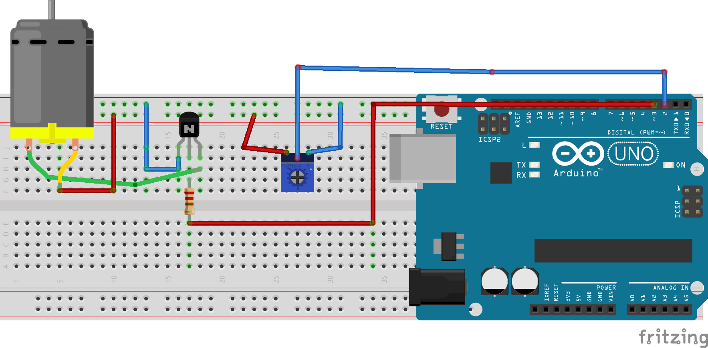

We simply adjust the pot to increase or decrease the duty cycle and the code below prints the PWM value to the serial monitor output.

```cpp
#include <Arduino.h>

int motorPin = 3;
int potPin = 2;

void setup()
{
  Serial.begin(115600);
  pinMode(motorPin, OUTPUT);
  pinMode(potPin, INPUT);
}

void loop()
{
  int potVal = analogRead(potPin);
  int mappedVal = map(potVal, 0, 1023, 0, 255);
  Serial.println(mappedVal);
  analogWrite(motorPin, mappedVal);
}
```

You should see something like this printing to the output as you adjust the potentiometer.


## Putting it all together

So we’ve tested with the motor, and we can visualize the best duty cycle value for our output. I dont want us to burn an entire Arduino board just for this basic setup though, thats where the 555 Timer comes in.

[Checkout the datasheet for all of the info I discuss below.](http://www.ti.com/lit/ds/symlink/lm555.pdf)

### 555 Timer Setup

The 555 timer is considered the *industry standard* when it comes to single IC timer oscillators (seems like a niche). The 555 timer gets its name because of the 3 internally connected 5k resistors it uses to generate the 1/3 and 2/3 reference voltage for the comparators.

#### Block diagram

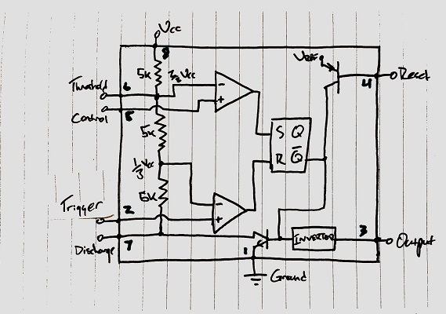

- **Pin 1 – Ground** The ground pin connects the 555 timer to the negative supply rail.
- **Pin 2 – Trigger** A negative pulse on this pin sets the internal Flip-flop when the voltage drops below 1/3Vcc causing the output to switch from a *low* to a *high* state.
- **Pin 3 – Output** The output pin can drive any TTL circuit and is capable of sourcing or sinking up to 200mA of current at an output voltage equal to approximately Vcc - 1.5V so small speakers, LEDs or motors can be connected directly to the output.
- **Pin 4 – Reset** A negative pulse to this pin is used to *reset* the internal Flip-flop.
- **Pin 5 – Control Voltage** This pin controls the threshold and trigger levels. The width of the output signal can be varied independently of the RC timing network. When not used it is connected to ground via a 10nF capacitor to eliminate any noise.
- **Pin 6 – Threshold** The positive input to the comparator. This pin is used to reset the Flip-flop when the voltage applied to it exceeds 2/3Vcc causing the output to switch from a *high* to a *low* state.
- **Pin 7 – Discharge** The discharge pin is connected directly to the collector of an internal NPN transistor which is used to discharge the timing capacitor to ground when the output at pin 3 switches low.
- **Pin 8 – Supply +Vcc** This is the power supply pin and for general purpose TTL 555 timers is between 4.5V and 15V.

---

> NOTE: The typical Astable circuit for the 555 Timer is only capable of acheiving duty cycles of >= 50%. That circuit can be pulled from the datasheet:

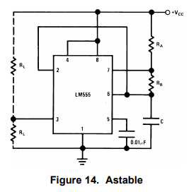

We will need to acheive a duty cycle of < 50%, so I will be using the below circuit for this application.

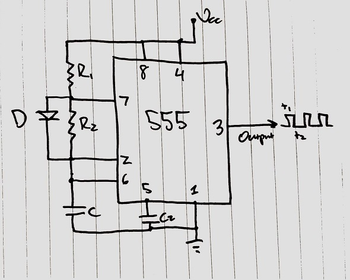

We want our timer to be setup as an astable oscillator, meaning that it will continue to oscillate spontaneously between states; in our case high and low. We would need to solve for the two resistor values `R1` and `R2`, as well as the threshold capacitor `C`. C2 can remain fixed at a small value connected to the control voltage, to prevent any transients or spikes.

By connecting the diode `D` across R2, the capacitor `C` will now charge through R1 only, as R2 will be shorted by the diode during the charging cycle. The capacitor still discharges through R2.

#### Charge and discharge times

We get the charge and discharge times, which will determine the duty cycle, from the following equations (remember, we are no longer charging through R2, so our equation for `ton` changes):

$$
\begin{gathered}
t_{on} = 0.693\times R_1\times C \\
t_{off} = 0.693 \times R_2 \times C
\end{gathered}
$$

So based on my testing, I’ve found that the optimal PWM value from the Arduino is `70` for this project. With a maximum value of `255`, that means a duty cycle of `27.45%`. We need to just figure out the value of `R1`, `R2` and `C`.

That will lead us into the equations for duty cycle, frequency and period, and how they relate to the timer configuration.

#### 555 Timer Equations

Below are the equations we will need to solve to figure out the component values, however the datasheet has a handy graph which can allow us to quickly determine some values.

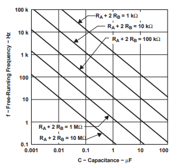

I’ll choose a capacitor value of **1μF**, since I didnt plan this out at all and this was the lowest value I had laying around.

If I choose (R1 + R2) to be roughly **1kΩ** (not 2R2, since its no longer included in the charging cycle), then that will result in a frequency of a little over **1kHz**.

We can substitute these values into the below equations to determine some results.

##### Period

$$
\begin{gathered}
T = t_{on} + t_{off} \\
T = (0.693\times R_1\times C) + (0.693 \times R_2 \times C) \\
T = 0.693(R_1 + R_2)\times C
\end{gathered}
$$

This results in a period of **693μs**.

---

##### Frequency

$$
\begin{gathered}
f = \frac{1}{T} \\
f = \frac{1.44}{(R_1 + R_2)\times C}
\end{gathered}
$$

This gives us a frequency of **1.443kHz**.

---

##### Duty Cycle

$$
\begin{gathered}
D = \frac{t_{on}}{T} \\
D = \frac{t_{on}}{t_{on} + t_{off}} \\
D = \frac{R_1}{R_1 + R_2}
\end{gathered}
$$

As stated above, the optimal duty cycle appears to be **27.45%**, and **(R1 + R2) = 1000**. So

$$
R_1 = 274.5\Omega
$$

Based on standard resistor values (and what I had laying around), we can roughly select R1:

$$
R_1 = 220\Omega \\
R_2 = 820\Omega
$$

Close enough! We now have all the values we need for our 555 timer circuit. We can put this together on a breadboard to test it out.

### The prototype

So just to recap all of the calculated values we need for the 555 timer circuit:

$$
R_1 = 220\Omega \\
R_2 = 820\Omega \\
C = 1\mu F \\
D = 21.1\% \\
V_{in} = 5V \\
f = 1.384kHz \\
T = 722\mu F
$$

After putting the timer together, I confirmed the output meets our expectation on an oscilloscope.

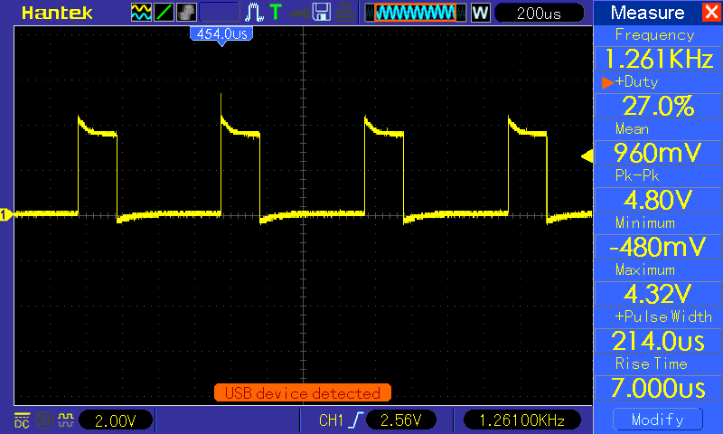

Success! Due to the tolerances of the components, we ended up getting a duty cycle that was closer to what we wanted originally.

We can now connect the output of the timer to the motor according to this schematic:

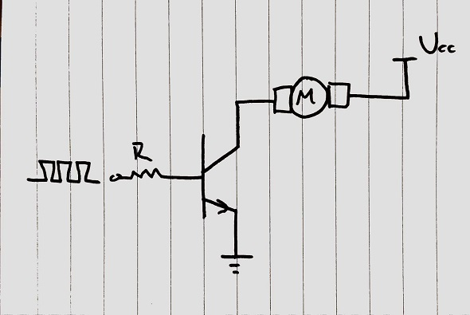

And now our motor is really moving. My helping hands looks like its wielding a deadly weapon. I’ll have to watch out…

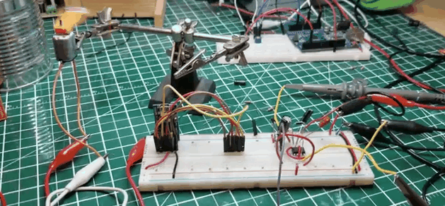

And thats it really. I’m going to solder it to a board for the final project, and perhaps look at decreasing the speed a bit since it might be a bit fast when its actually in the enclosure.

#### Improvements to the design

If you connect the output of the transistor to an oscilloscope, then you’ll notice that we’re seeing a waveform with high voltage transients and distortion:

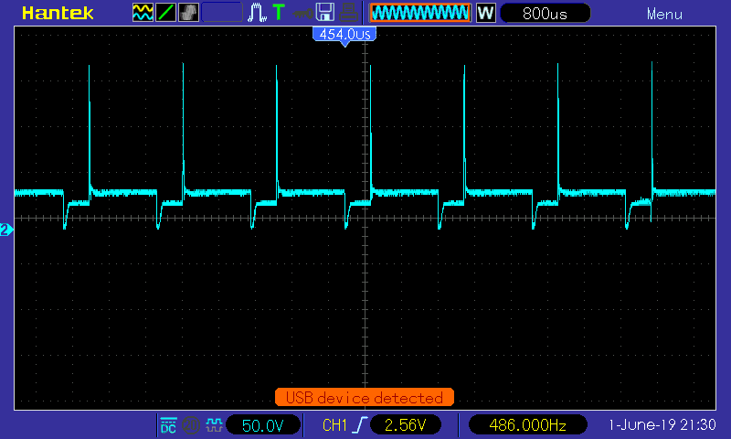

This is a result of the back emf of the motor. You can checkout more about that [here](https://youtu.be/qwtiX3pFCIE).

We can resolve this by placing a diode in parallel across the motor, which will suppress the reverse voltage from inductive loads and short it back ot our power supply. Its also known as a [flyback diode](https://en.wikipedia.org/wiki/Flyback_diode).

This should reduce a lot of the spikes we’re noticing and square the waveform a bit more.

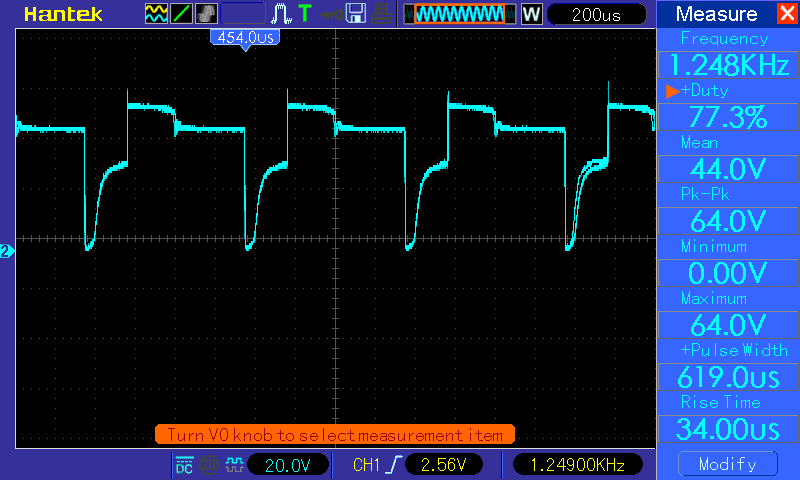

However this can still be improved. You are likely hearing a high pitch noise while the motor is rotating. When motors with brushes are running normally, the motor brushes produce sparks which cause radio interference. This has nothing to do with PWM and happens even when these motors are connected directly across a battery. When using PWM to drive the motor, while the transistors turn on, the motor may pull a surge current. When the transistors turn “off”, the motor inductance may cause voltage spikes.

Attaching a capacitor across the motor can absorb the RF noise due to the commutator arcing. This will also eliminate the transients, and ultimately smooth out the waveform and quiet the motor.

I should note that I used trial and error to find a capacitor value for this, **220μF**.

Heres the final circuit on my protoboard.

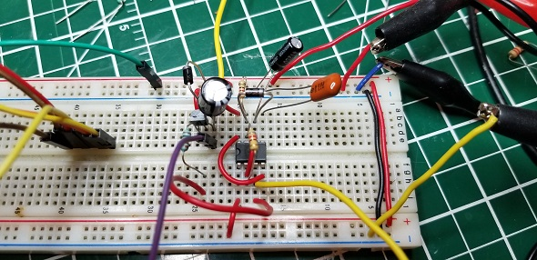

Thanks for reading!
