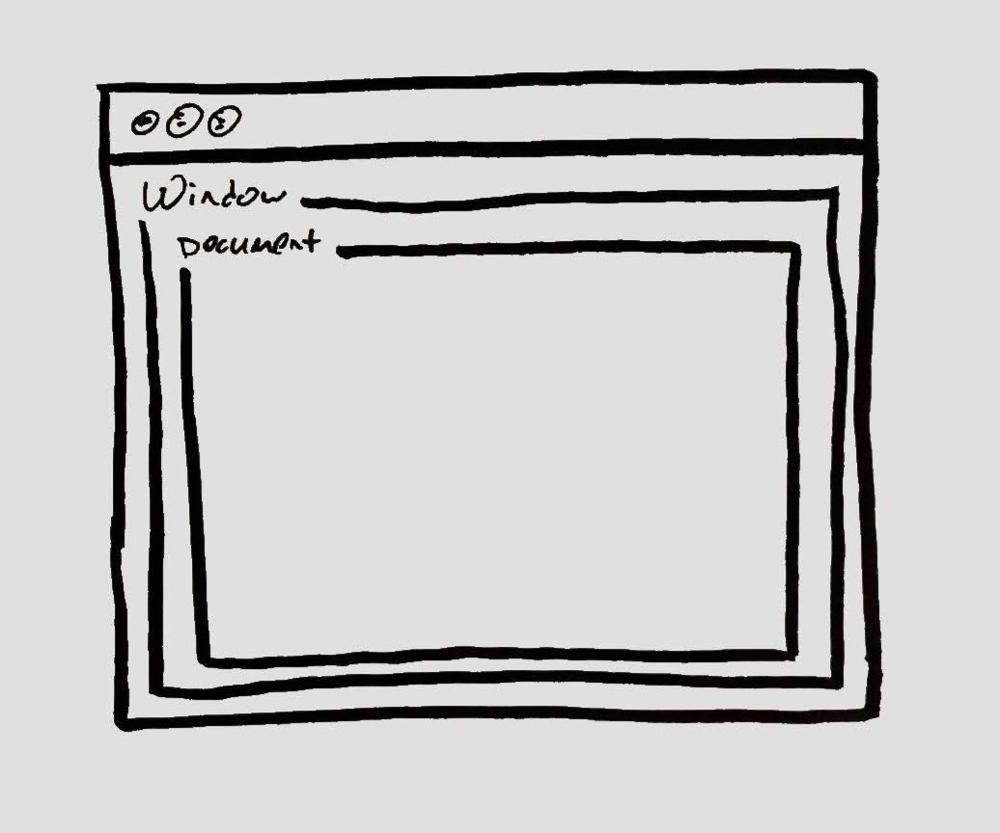

I recently came across a small issue while building the responsive navbar for my blog. I needed to detect the screen size the user was on, so that I could apply specific classes to some of the elements (profile picture, bio etc.). I was already using media queries and bootstrap to take care of some of this CSS side, but because of how some of the styes were setup I found that it was more useful for me to do it based on class names.

To acheive this, I used `Event Listeners`. These are functions that wait for an event to occur. The listener reacts to an input by calling the event handler (the function we want to trigger).

You’ve likely seen these counteless times before:

```js
document.getElementById('button').addEventListener('click', handleClick)

const handleClick = () {
  console.log('Ive been clicked!')
}
```

In other languages, subroutines that perform similar funcitons are referred to as **event handlers**.

## document vs. window

Before I discuss the implementation I used, I just want to talk briefly about the `window` object and the `document` object. It is important to note that these are not the same, and you will want to attach event listeners to one or the other depending on your application.

The `window` is the first thing that gets loaded into the browsers. It has the properties like length, innerWidth, name, etc.

The `document` object contains the html, php or other code that will be loaded into the browser. The document gets loaded inside the window object and has properties available to it such as title and URL.



So that means that if you want to access a property for the window, you use the syntax `window.prop` and if you want to access a property for the document you use the syntax `window.document.prop`, which can be shorthanded to `document.prop`.

You can find a list of properties for [window](https://www.w3schools.com/jsref/obj_window.asp) and [document](https://www.w3schools.com/jsref/dom_obj_document.asp).

## Recognizing Window width

So with this knowledge of the `window` object, we can continue.

The property that I needed access to for this was `window.innerWidth`. This will return the width of the users browser window in pixels.

I was using React, so I needed to store the state and check for the width when the component mounted.

```js
class Layout extends React.Component {
  state = {
    active: true,
  }

  handleResize = e => {
    if (window.innerWidth > 992) {
      this.setState(() => ({
        active: false,
      }))
    }
  }

  componentDidMount() {
    window.addEventListener("resize", this.handleResize)
  }

  componentWillUnmount() {
    window.removeEventListener("resize", this.handleResize)
  }

  ...render JSX

}
```

Lets break down what I’m doing here.

This is the method that will handle setting my state for the current `window.innerWidth` value. I check if its greater than 992px, and if so change the `active` property in our state to false. Nothing earth shattering here.

```js
handleResize = e => {
  if (window.innerWidth > 992) {
    this.setState(() => ({
      active: false,
    }))
  }
}
```

Now, I need to check for this when the page loads. This is where our `event listeners` come into play. I used [this section](https://react-cn.github.io/react/tips/dom-event-listeners.html) of the React docs to determine where my listeners should go.

When the page loads and the component mounts, I want to see if the page has been resized, and if so call our resize handler method.

```js
  componentDidMount() {
    window.addEventListener("resize", this.handleResize)
  }
```

When the component mounts, we add an *event listener* to the *window* object called `resize`. You can read more about it in the [MDN docs](https://developer.mozilla.org/en-US/docs/Web/API/Window/resize_event), but essentially this event just fires when the window has been resized. `componentDidMount` is usually where you would attach DOM events.

Now we could just stop here, but we’ll experience a lot of issues with our application (I had the browser window locking up on me). We need to remove the event listener at some point.

The event listeners need to be removed for the following reasons:

- Avoid memory leaks
- Avoid collisions of events of components
- Remove the side effects when the event listeners are stored in some kind of persistent storage

We want to remove our event listener when our component is unmounted, or about to unmount.

```js
  componentWillUnmount() {
    window.removeEventListener("resize", this.handleResize)
  }
```

So when the component is going to unmount, we just remove the event listener from our handler.

And thats it. I hope this gave some useful insight on how you can use event listeners to listen for changes to window or document properties. This was a bit of a TIL for me, as I had only used listeners very simply but never dove into lower level use/meaning behind them.

Thanks for reading!
