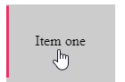

Checkout the final result on [Codepen](https://codepen.io/irowell/pen/QRbyWG)

---

I’m currently taking a course for Advanced CSS/SASS ([Online Courses - Anytime, Anywhere | Udemy](https://www.udemy.com/share/100YxSAkUScF9XQ3Q=/)). In there, the instructor shows a very modern looking way of building a hover effect for a button or list. I want to share that with you.

Heres what we will be building:


First, lets build up the HTML. All we need is a container and a list with some items in it.

```html
<div class="container">
  <ul class="nav">
    <li class="nav__item"><a class="nav__link">Item one</a></li>
    <li class="nav__item"><a class="nav__link">Item two</a></li>
  </ul>
</div>
```

*Note: The class naming syntax I use above is the BEM (Block Element Modifier) methodology, if you havent heard of or used it before I recommend checking it out [here](http://getbem.com/)*

Now we can setup some basic styles…

```sass
// here we center the list on the page
.container {
  display: flex;
  justify-content: center;
}

// set the color, remove styles and make the spacing bigger
.nav {
  background-color: #ccc;
  list-style: none;
  padding: 0;
  &__item {
    padding: 2rem;
  }

  &__item:hover{
    cursor: pointer;
  }
}
```

Ok. Now we just have a list. Not very compelling though. Since we all know adding more CSS will make it better lets do that…

```sass
.nav {
...

  &__item {
    padding: 2rem;
    position: relative
  }

  &__item::before {
    content: "";
    position: absolute;
    top: 0;
    left: 0;
    height: 100%;
    width: 3px;
    background-color: #eb2f64;
    transform: scaleY(0);
    transform-origin: bottom;
    transition: transform 0.2s, width 0.4s cubic-bezier(1, 0, 0, 1) 0.2s;
  }

  &__item:hover::before{
    transform: scaleY(1);
    width: 100%;
  }

  &__link {
  position: relative;
  z-index: 999;
  }

}
```

I know theres a lot going on above. So lets break it down.

```scss
&__item {
  padding: 2rem;
  position: relative;}
```

First, we set the `nav__item` to relative positioning. We will need this to corectly position the *before* pseudo element.

```sass
  &__item::before {
    content: "";
    position: absolute;
    top: 0;
    left: 0;
    height: 100%;
    width: 3px;
    background-color: #eb2f64;
    transform: scaleY(0);
    transform-origin: bottom;
    transition: transform 0.2s, width 0.4s cubic-bezier(1, 0, 0, 1) 0.2s;
  }
```

This sets the `before` pseudo element for the `nav__item` class.

What we can do with this element is set html code using CSS, without actually chaning the html file.

This element will be rendered *before* the `nav__item` element in the html. We set the `position` to `absolute`, and its `top and left` postion to 0. This way the element is positioned all the way to the left of the `__item` element. With `height: 100%` and `width: 3px`, as well as setting the color, we get an element that looks similar to below.



Now we want the effect where on hover, the element shoots up from the bottom and then expands the width of the list item.

```sass
transform: scaleY(0);
transform-origin: bottom;
transition: transform 0.2s, width 0.4s cubic-bezier(1, 0, 0, 1) 0.2s;
```

What these lines do are

- scale the element to 0 in the Y direction
- set the origin for the transformation to the bottom
- set the transition speed and function for the element

  - take 0.2s to transform from the bottom
  - follow the cubic bezier curve function for expanding the width

If you arent familiar with the cubic-bezier, I’ll be discussing this in another blog. Its just an easing function to specify the rate of change of a particular action over time.

See [Easing Functions Cheat Sheet](https://easings.net/en) for more details.

Now we want the effect when we hover

```sass
  &__item:hover::before{
    transform: scaleY(1);
    width: 100%;
  }
```

So when we hover the `__link` element, the before pseudo element will scale to 100% in the Y direction and increase its width to 100%.

Lastly, we need to force the link element (the element that contains the text) to the top of the stack. Otherwise you’ll notice that the *before* element covers the text of the list item.

```scss
&__link {
  position: relative;
  z-index: 999;
}
```

To set an elements `z-index`, it needs to be positioned. We set this to `relative` since we dont want it to move with repect to the `__link` element, our other relatively positioned element. Set the z-index to anything high so it appears at the top.

And there we go! Now you have a sleek and stylinsh hover effect for your webpage.
